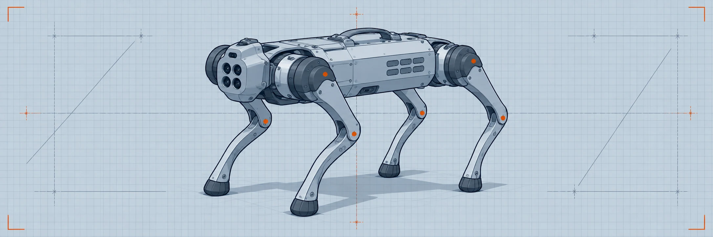
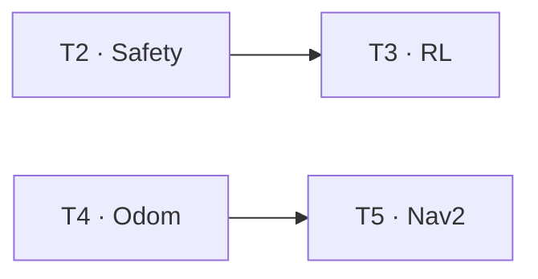

# EOL / RoboHack 2.0



Заочный этап: управление Go1, одометрия и навигация в симе. Стек: `ROS 2 Humble`, `MuJoCo`, `Gazebo`, `Docker`.

[Общее ТЗ (PDF)](docs/technical-specification.pdf) | [Запуск симулятора](docs/simulator.md) | [Чек-лист сдачи](docs/submission.md) | [ЛК RoboHack](https://robohack.mirea.ru/cabinet)

## Статус этапов

| Этап | Дедлайн (МСК) | Что готово | Статус |
| --- | --- | --- | --- |
| [T1 / Контейнер](stages/T1/) | **19.11, 12:00** | Образ и `ping`. [CI: офлайн, без root](https://github.com/tim1363/hackaton-EOL/actions/runs/44300117644). | **Готово, осталось отправить** |
| [T2 / Safety](stages/T2/) | 21.11, 12:00 | Ядро и экспериментальный ROS-узел; опробован вместе с T3. | **В работе**, полная проверка не завершена |
| [T4 / Odom](stages/T4/) | 24.11, 12:00 | Начальный прототип LiDAR + IMU и синтетические тесты. | **Прототип**, в симуляторе не проверен |
| [T3 / RL](stages/T3/) | 27.11, 12:00 | Своя PPO-политика; 10/10 пробных заездов через оптимизированный T2 в публичном симуляторе при одинаковой стартовой позе. | **В работе**, Judge и сдача не проверены |
| [T5 / Nav2 + ArUco](stages/T5/) | 27.11, 12:00 | Контракты Nav2, TF и детектора. | `TODO` |

> [!IMPORTANT]
> **CI зелёный, в ЛК не сдано.** На 18.11.2026 в команде было 4/6 участников, приём для команды заблокирован. Капитану: проверить состав, подготовить публичный коммит и выгрузить образ в Harbor. Дедлайн T1: **19.11.2026 в 12:00 МСК**.

## Быстрый старт

Нужен доступ к этому приватному репо. Команды ниже для Bash на машине с Docker Engine и Buildx.

```bash
git clone https://github.com/tim1363/hackaton-EOL.git
cd hackaton-EOL

# Сначала ping. Гулять пойдём в T3.
docker buildx build --platform linux/amd64 --load -t robohack-participant:t1 stages/T1
python3 stages/T1/verify_t1.py robohack-participant:t1
```

Нет Docker под рукой? [Посмотрите успешный прогон T1](https://github.com/tim1363/hackaton-EOL/actions/runs/44300117644).

## Как делим работу

Приоритет — **T2 и T3**, T4 параллельно при наличии ресурсов. Для локальных прогонов используем [публичный сим](docs/simulator.md); закрытого Judge в нём нет.



- В каждом `stages/T*`: исходный `spec.pdf`, контракт и следующий шаг. Источник PDF указан в [docs](docs/).
- Один этап на ветку: `t2/safety`, `t4/odom`. В PR пишем, что менялось, какой командой проверили и где лог.
- Пароли Harbor, токены, файлы ЛК и образы в Git не кладём. Судьям нужен публичный коммит; этот репозиторий остаётся рабочим и приватным.
