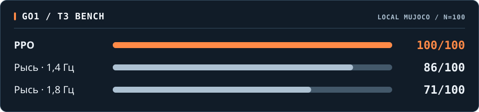

# EOL / RoboHack 2.0


Unitree Go1 · ROS 2 Humble · MuJoCo / Gazebo

[ТЗ](docs/technical-specification.pdf) · [Симулятор](docs/simulator.md) · [Сдача T1](docs/submission.md) · [Кабинет](https://robohack.mirea.ru/cabinet)

## T3 / Locomotion

[](stages/T3/#mujoco-benchmark)

Актор PPO: **7 884 параметра**, 3 м в среднем за **7,99 с**, без падений. Это [отдельный локальный бенчмарк](stages/T3/#mujoco-benchmark), не зачёт Judge.

## Этапы

| Этап | Дедлайн (МСК) | Что готово | Статус |
| --- | --- | --- | --- |
| [T1 / Контейнер](stages/T1/) | 19.11, 12:00 | [Образ в Harbor и коммит для сдачи](docs/submission.md) | Сдача не подтверждена |
| [T2 / Safety](https://github.com/tim1363/hackaton-EOL/tree/t2-t3-mishanya/stages/T2) | 21.11, 12:00 | Защита суставов, ROS-узел и локальные тесты | В работе |
| [T4 / Odom](https://github.com/tim1363/hackaton-EOL/tree/t2-t3-mishanya/stages/T4) | 24.11, 12:00 | Прототип LiDAR + IMU | Проверить в Gazebo |
| [T3 / RL](stages/T3/) | 27.11, 12:00 | Локальная PPO и [кандидаты команды](https://github.com/tim1363/hackaton-EOL/tree/t2-t3-mishanya/stages/T3) | Сравнить в публичном симуляторе |
| [T5 / Nav2 + ArUco](stages/T5/) | 27.11, 12:00 | Список топиков и проверок | Нет реализации |

T3 использует защиту T2, T5 использует одометрию T4. В PR оставляйте команду запуска и лог проверки.

## T1 / Smoke test

Из корня репозитория, с Docker и Buildx:

```bash
docker buildx build --platform linux/amd64 --load -t robohack-participant:t1 stages/T1
python3 stages/T1/verify_t1.py robohack-participant:t1
```

Без Docker: [лог проверки T1 в CI](https://github.com/tim1363/hackaton-EOL/actions/runs/44300117644).
